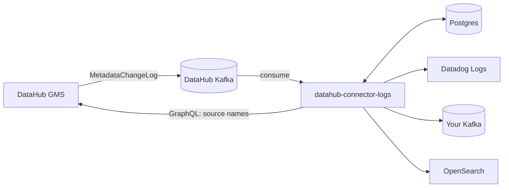

# DataHub connector logs

Browse the ingestion runs of your [DataHub](https://datahubproject.io) instance, read the full log of any failed run, and forward those logs to **Datadog**, **Apache Kafka** or **OpenSearch**.

DataHub keeps ingestion logs inside DataHub and offers no way to ship them elsewhere. This app fills that gap: it listens to DataHub's own Kafka topic, keeps a searchable copy of every run in Postgres, and delivers the runs you choose to the destinations you configure, all from a small web UI.



## Features

- **Runs browser.** Every ingestion run with status, source, start time, duration and a one-line reason for failures. Filter by status, source or log text, and hide sources you don't care about.
- **Full logs.** Open any run to read its complete log with error lines highlighted, or download it.
- **Problems view.** Failed, timed-out, aborted and cancelled runs, plus runs stuck in `RUNNING` (which DataHub never reports as failed).
- **Integrations.** Send logs to Datadog, Kafka or OpenSearch with a form per destination, a **Test connection** button, per-integration filters (statuses, sources, max log size), automatic retries and delivery counters.
- **Stateless; credentials encrypted at rest.** All state lives in Postgres, integration credentials and the DataHub connection are encrypted before they are stored, and the UI is behind a login. The image ships public default credentials that you must replace, see the [disclaimer](#disclaimer-and-known-issues).

## Quick start

You need Docker with Compose, a DataHub with an access token, and the connection details of the Kafka cluster DataHub uses.

1. **Collect the DataHub details** (you'll enter them in the app in step 5).
   - The URL of DataHub's backend (GMS), not the web UI.
   - An access token: in DataHub, *Settings → Access Tokens → Generate new token*. Its user needs the **Manage Ingestion** privilege.
2. **Get access to DataHub's Kafka.** On Aiven, open the Kafka service's *Connection information* and keep `ca.pem`, `service.cert`, `service.key`, plus the service host and port.
3. **Configure.**

   ```bash
   cp .env.example .env
   # optional: nothing is required; see docs/configuration.md for the security options
   ```
4. **Start.**

   ```bash
   docker compose up -d --build
   ```

5. Open <http://localhost:8000>, sign in (default `admin` / `change-me-now`, change it before exposing the app: see [Configuration](docs/configuration.md)), and fill in the **Settings** tab: DataHub URL and token, Kafka host and port, and the PEM text of the CA, client certificate and key. **Test connection**, then **Save**.

On first start the app replays what is still in the Kafka topic (24 hours on the topic this was built against) so the Runs tab fills up straight away.

## Using the app

**Runs tab.** The default filter shows problems only. Use *Status* for a specific outcome or *All runs*, *Source* to look at one ingestion source, *Hide sources* to exclude noisy ones (remembered in your browser), and *Search log text* to search inside the logs. **View log** opens the full log; the view jumps to the first error line.

**Integrations tab.** Pick a destination card, fill in the form and press **Test connection** to send a sample event, then **Save**. By default an integration sends failed runs from all sources, and only runs that finish after it was created. Tick *SUCCESS* to send successful runs too, or *Also send runs already collected* to backfill. The table shows how many runs were delivered, are pending retry or failed for good; the row menu lets you edit, pause, retry or delete. See [docs/integrations.md](docs/integrations.md) for each destination and the event format.

## Documentation

| | |
|---|---|
| [How it works](docs/how-it-works.md) | Data flow, delivery guarantees, data model, HTTP API |
| [Configuration](docs/configuration.md) | Every environment variable |
| [Integrations](docs/integrations.md) | Datadog, Kafka, OpenSearch, event format, adding a new destination |
| [Deployment](docs/deployment.md) | Docker Compose, Aiven, external Postgres/Kafka, TLS, backups, upgrades |
| [Security](docs/security.md) | What is encrypted, trust model, key rotation, hardening checklist |
| [Troubleshooting](docs/troubleshooting.md) | Symptoms and fixes |
| [Development](docs/development.md) | Running locally, tests, project layout |
| [Reading ingestion logs over the API](docs/reading-logs-over-the-api.md) | Background: what DataHub exposes and why this app reads Kafka instead |

## Limits worth knowing

- **History starts at the Kafka retention window** (24 hours on the Aiven topic this was built against; check the topic's `retention.ms`). The app can't see runs older than that unless it was already running.
- **Only finished runs are delivered.** Runs still `RUNNING` are shown in the UI but sent to destinations once they reach a final status.
- **Delivery is at-least-once.** A run can reach a destination twice after a crash. The Kafka key and the OpenSearch document id are the run id, so consumers can deduplicate.
- **Run logs are stored unencrypted** in Postgres (so they can be searched). Credentials for integrations are encrypted.
- **One admin account**, set through environment variables.

## Disclaimer and known issues

This software is provided "as is", without warranty of any kind (see the [Apache License 2.0](LICENSE)). Review the issues below before deploying it, and run it only where they are acceptable (see [Security](docs/security.md) for the trust model and hardening checklist).

### Security

- **Public default credentials.** The image ships with a default admin login (`admin` / `change-me-now`) and a default `APP_ENCRYPTION_KEY`, both published in this repository. Until you replace them, anyone who can reach the app can sign in as admin, and anyone with a copy of the database can decrypt every stored credential (DataHub token, Kafka certificates and key, integration passwords and API keys). The Settings tab warns while they are in use, but the app does not refuse to start.
- **Run logs are stored unencrypted.** Ingestion logs can contain hostnames, paths, table names and fragments of configuration. They sit in Postgres as plain text (so they can be searched) for `RETENTION_DAYS` (default 7). `DISABLE_LOG_BROWSING=1` turns off the logs API and shortens retention.
- **One shared admin login.** There are no per-user accounts, roles or audit trail. Anyone who signs in can read every log and manage every integration.
- **The app can be pointed at internal hosts.** Integrations and the DataHub connection may target private and loopback addresses. Link-local and cloud-metadata addresses are refused, but only when the form is saved, so DNS rebinding is not prevented.
- **Basic login protection only.** A failed login is delayed by one second; there is no rate limiting or lockout. Each attempt also uses about 16 MB of memory for password hashing, so a burst of concurrent attempts can exhaust a small container. Sessions last 7 days with no idle timeout, and changing the password does not end existing sessions.
- **No TLS of its own.** The app serves plain HTTP on port 8000 and relies on the platform for HTTPS. On Aiven this is provided: the app is only reachable through an `https://` URL.
- **Broad Kafka access.** The app reads `MetadataChangeLog_Versioned_v1`, which carries every metadata change in DataHub, not only ingestion runs. Use a dedicated Kafka user with read-only access to that topic and its consumer group. Do not reuse DataHub's own service user: it can write to DataHub's topics, so anyone who obtains it can change metadata in DataHub.

### Reliability

- **Undecodable messages are skipped, and that is easy to miss.** A message that can never be decoded or stored is retried three times and then dropped, so one bad message can't block the rest. It is recorded only in the app log and as a counter in the UI header, which resets when the app restarts. Problems on DataHub's side (an expired token, GMS being down) are never skipped: the consumer keeps retrying and shows the error in the header.
- **Deliveries give up after about 15 minutes.** A run that fails to reach a destination is tried five times in total (retries after 1, 2, 4 and 8 minutes) and then marked as failed for good. Retrying it needs **Retry failed** in the Integrations tab, and only works while the run is still within `RETENTION_DAYS`. A destination outage longer than about 15 minutes therefore needs manual action.
- **Some runs may never be delivered.** A run is only delivered once its source name is resolved through DataHub's GraphQL API. If that keeps failing (for example the token lacks *Manage Ingestion*), the run waits until it is deleted by retention, with only a warning in the app log.
- **The health check does not reflect the app's state.** `GET /healthz` always returns `{"ok": true}`, even if the consumer or delivery worker has stopped. Consumer errors, skipped messages and failed deliveries are visible only in the UI and the app log; the app sends no alerts.
- **History is limited to what Kafka still holds** (24 hours on the Aiven topic this was built against) and delivery is at-least-once, so a run can reach a destination twice.

## License

[Apache License 2.0](LICENSE).
