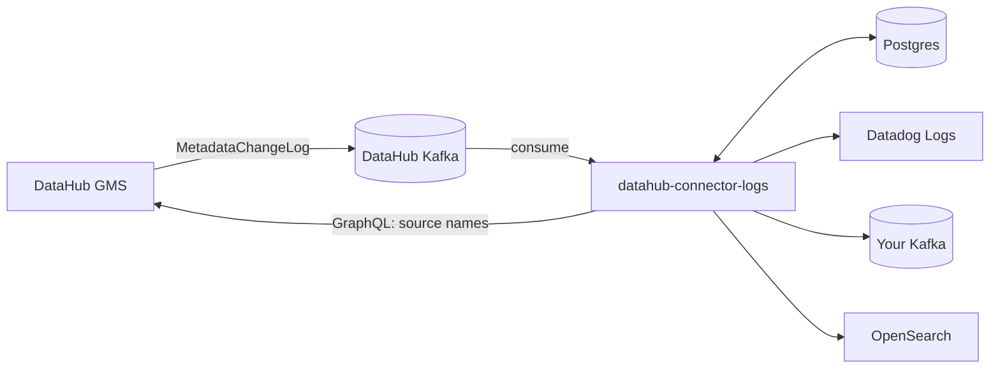

# DataHub connector logs

Browse the ingestion runs of your [DataHub](https://datahubproject.io) instance, read the full log of any failed run, and forward those logs to **Datadog**, **Apache Kafka** or **OpenSearch**.

DataHub keeps ingestion logs inside DataHub and offers no way to ship them elsewhere. This app fills that gap: it listens to DataHub's own Kafka topic, keeps a searchable copy of every run in Postgres, and delivers the runs you choose to the destinations you configure, all from a small web UI.



## Features

- **Runs browser.** Every ingestion run with status, source, start time, duration and a one-line reason for failures. Filter by status, source or log text, and hide sources you don't care about.
- **Full logs.** Open any run to read its complete log with error lines highlighted, or download it.
- **Problems view.** Failed, timed-out, aborted and cancelled runs, plus runs stuck in `RUNNING` (which DataHub never reports as failed).
- **Integrations.** Send logs to Datadog, Kafka or OpenSearch with a form per destination, a **Test connection** button, per-integration filters (statuses, sources, max log size), automatic retries and delivery counters.
- **Stateless and secure by default.** All state lives in Postgres, integration credentials are encrypted before they are stored, and the UI is behind a login.

## Quick start

You need Docker with Compose, a DataHub with an access token, and the connection details of the Kafka cluster DataHub uses.

1. **Collect the DataHub details** (you'll enter them in the app in step 4).
   - The URL of DataHub's backend (GMS), not the web UI.
   - An access token: in DataHub, *Settings → Access Tokens → Generate new token*. Its user needs the **Manage Ingestion** privilege.
2. **Get access to DataHub's Kafka.** On Aiven, open the Kafka service's *Connection information* and keep `ca.pem`, `service.cert`, `service.key`, plus the service host and port.
3. **Configure.**

   ```bash
   cp .env.example .env
   # optional: nothing is required; see docs/configuration.md for the security options
   ```
4. **Start.**

   ```bash
   docker compose up -d --build
   ```

5. Open <http://localhost:8000>, sign in (default `admin` / `change-me-now`, change it before exposing the app: see [Configuration](docs/configuration.md)), and fill in the **Settings** tab: DataHub URL and token, Kafka host and port, and the PEM text of the CA, client certificate and key. **Test connection**, then **Save**.

On first start the app replays what is still in the Kafka topic (about the last 24 hours on Aiven) so the Runs tab fills up straight away.

## Using the app

**Runs tab.** The default filter shows problems only. Use *Status* for a specific outcome or *All runs*, *Source* to look at one ingestion source, *Hide sources* to exclude noisy ones (remembered in your browser), and *Search log text* to search inside the logs. **View log** opens the full log; the view jumps to the first error line.

**Integrations tab.** Pick a destination card, fill in the form and press **Test connection** to send a sample event, then **Save**. By default an integration sends failed runs from all sources, and only runs that finish after it was created. Tick *SUCCESS* to send successful runs too, or *Also send runs already collected* to backfill. The table shows how many runs were delivered, are pending retry or failed for good; the row menu lets you edit, pause, retry or delete. See [docs/integrations.md](docs/integrations.md) for each destination and the event format.

## Documentation

| | |
|---|---|
| [How it works](docs/how-it-works.md) | Data flow, delivery guarantees, data model, HTTP API |
| [Configuration](docs/configuration.md) | Every environment variable |
| [Integrations](docs/integrations.md) | Datadog, Kafka, OpenSearch, event format, adding a new destination |
| [Deployment](docs/deployment.md) | Docker Compose, Aiven, external Postgres/Kafka, TLS, backups, upgrades |
| [Security](docs/security.md) | What is encrypted, trust model, key rotation, hardening checklist |
| [Troubleshooting](docs/troubleshooting.md) | Symptoms and fixes |
| [Development](docs/development.md) | Running locally, tests, project layout |
| [Reading ingestion logs over the API](docs/reading-logs-over-the-api.md) | Background: what DataHub exposes and why this app reads Kafka instead |

## Limits worth knowing

- **History starts at the Kafka retention window** (24 hours on Aiven by default). The app can't see runs older than that unless it was already running.
- **Only finished runs are delivered.** Runs still `RUNNING` are shown in the UI but sent to destinations once they reach a final status.
- **Delivery is at-least-once.** A run can reach a destination twice after a crash. The Kafka key and the OpenSearch document id are the run id, so consumers can deduplicate.
- **Run logs are stored unencrypted** in Postgres (so they can be searched). Credentials for integrations are encrypted.
- **One admin account**, set through environment variables.

## License

[Apache License 2.0](LICENSE).
